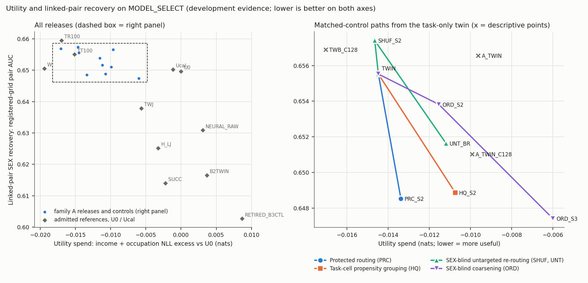

# Advisor brief: does fitting the propensity-aware finite routing help?

Campaign `pcrl_finite_routing_comparison_v1`, 2026-10-20/21 (start 22:49:23Z). Florida ACS 2019 development cohort (admitted
public-use PUMS records): MODEL_FIT, CALIBRATION and MODEL_SELECT roles only. Six input fields. An income recipient and an occupation
recipient each receive only their own probability vector and argmax decision; no routing index or cell identity is released. Separate
evaluation classifiers ("readers") estimate the recorded SEX column from the released vectors, and "recovery" is their AUC.

This campaign picks up family A (propensity-routed finite cells, card FA_PRC_v1) of `pcrl_new_release_mechanisms_v1`. That campaign
closed the family at its capacity stage, so protected routing was never fitted. Everything below is development evidence on
adaptively used MODEL_SELECT records, for the declared readers only.

**Result in one line:** under the post hoc grid-validity repair ER1, an engineering repair (`ENGINEERING_REPAIR`). The task-only
finite release was repaired and the protected routing was fitted, but its recovery reduction was not separated from what matched
controls achieve at the same task cost. Without ER1, D2-D4 are not computed and the outcome class is `INCOMPLETE`. The statistical
reviewer's required headline is in `RESEARCH_DECISION.md`.

*Left: every release and the admitted references. Right: the matched-control paths from the task-only twin. x = income + occupation
NLL excess over U0 (nats, mean of the two versions; lower is more useful). y = registered-grid linked-pair AUC (8 cells; lower is less
recovery). Point estimates only; the uncertainty is in `TABLES.md`, and nothing in the picture is resolved. Table view:
`figures/FRONTIER.csv`.*

## The questions of the brief

**1. Did probability estimation explain the lost margin?** In part, and only in the sense measured here. On identical partitions
(the same people in the same cells), the out-of-fold teacher-mean tables (B1) were compared with the source's label-refit decoders
(A) on held-out occupation NLL:

| Capacity | B1 better than A, nested on MODEL_FIT | B1 better than A, on MODEL_SELECT |
|---|---|---|
| 16 x 64 cells | 0.0039 / 0.0049 nats | 0.0037 / 0.0055 nats |
| 24 x 128 cells | 0.0085 / 0.0090 nats | 0.0072 / 0.0062 nats |

- These reductions are resolved, at 3.3-8 se.
- They remove about 36% (16 x 64) and 62-68% (24 x 128) of the label-refit twin's nested occupation-NLL spend over the continuous
  task teachers (point ratios, without intervals).
- The stored prototypes (B0) give the same held-out NLL as B1 within 0.000005 nats.
- The remainder (0.0068 / 0.0088 nats at 16 x 64, 0.0052 / 0.0042 at 24 x 128) was not reduced by either teacher-mean construction.
  Whether it is the partition's own cost or remaining per-cell estimation error was not tested.
- The original 0.004 capacity gate still fails for every construction. It stays in its original record and was not used as the
  eligibility rule.

**2. Was a useful finite release obtained?** Yes, as a task-only release. The B1 twin at 16 x 64 (TWB_C64) meets all 24 original
clauses and 4 guards in both versions (worst clause / cap -0.164 and 0.037), with the S2 slack the qualification rule asks for. Its
two-SE reserve, reported and never gating, is 3.15 / 2.71. The source's label-refit twin fails the S2 slack on the version-1 men's
guard (0.00255 against 0.002); its reserve is 2.31 / 1.29. The repaired twin is the family's qualified task-only release (D1
`REPAIRED_TASK_ONLY_RELEASE`). It is not a privacy result: its pair AUC (0.6555) is 0.025-0.030 above the target references.

**3. Was the protected routing actually fitted?** Yes.
- **The objective.** Task cross-entropy plus strength times the plug-in SEX information of the pair cell and of each recipient's
  cell, with a per-SEX occupation guard. It uses a SEX propensity and a SEX-conditional occupation teacher trained with MODEL_FIT SEX
  labels.
- **The fit.** It ran on MODEL_FIT out-of-fold statistics with a damped, rule-consistent Lloyd chain. The B1 tables were recomputed
  on each configuration's own re-partition.
- **The strength choice.** The predefined budget path chose the strength on nested MODEL_FIT estimates, with no MODEL_SELECT label.
  The registered path produced one protected partition per version: strength 8, the top of the grid. S2 and S3 coincide, and the S2
  budget did not bind.
- **The result.** That partition (PRC_S2) re-routes 14.4% / 12.8% of MODEL_SELECT people relative to the twin. The fitted pair MI
  falls from 0.0357 / 0.0358 to 0.0332 / 0.0327 nats, and the nested held-out LOOKUP AUC falls by 0.0072 / 0.0111 (falsifier F4 passes
  in both versions). PRC_S2 meets every original limit.
- **Stronger settings.** A label-free probe, with its decision rule registered before it ran, found that the chain never changes
  partition above strength 8 in version 0. In version 1 it changes once, at 16, re-routing 39% of people. So no second revision was
  made, and the S3 budget point stays untested.

**4. Did it improve beyond matched controls?** No (D2 `NO_REDUCTION_BEYOND_ANY_CONTROL`). Registered-grid pair AUC:

| Release | Pair AUC | Benefit of PRC_S2 at matched spend |
|---|---|---|
| TWIN | 0.6555 | +0.0070 (se 0.0040), point only |
| PRC_S2 | 0.6485 | - |
| HQ_S2: routing on task scores only, SEX information only as cell means | 0.6489 | +0.0003 (se 0.0051), bracketing control |
| UNT_BR: SEX-blind keyed re-routing at PRC's spend (revision R1) | 0.6516 | +0.0031 (se 0.0076), bracketing control |
| ORD_S2: SEX-blind coarsening | 0.6538 | +0.0053 (se 0.0059), bracketing control |
| SHUF_S2: donor propensity, the registered untargeted control | 0.6574 | never reaches PRC's spend |

- **Frontiers.** Every frontier is `NOT_SEPARATED_FROM_TASK_SPENDING`. The reader-targeting rule fails against HQ_S2 and UNT_BR.
- **Against HQ_S2.** PRC_S2 and HQ_S2 reached about the same recovery (+0.0003, se 0.0051) and the same fitted pair MI. PRC_S2's
  primary task spend was 0.0026 nats lower (se 0.0014, not resolved), and it re-routed fewer people (14% vs 33% in version 0, 13% vs
  24% in version 1; re-routing is not a registered cost). No efficiency difference is established.
- **Interpolated paths.** Interpolated linearly at PRC_S2's spend (reported, never gating), the ORD path sits 0.0064 (se 0.0047)
  above PRC_S2. In the R1 reading only, the untargeted path sits 0.0068 (se 0.0054) above it. Both are about 1.3 se.
- **Ablations.** No component separates. ABL_LOC (pair weight 0: per-recipient terms only) and ABL_PAIR (local weights 0: the pair
  term alone) each land between the twin and PRC_S2: -0.0024 (se 0.0031) and -0.0032 (0.0042) against PRC_S2 on the registered cells.

**5. Did any benefit survive classifier refitting?** There was no resolved benefit to carry, and the refit confirmed none. Over 32
cells, every comparison is `ROBUSTNESS_NOT_CONFIRMED`. The cells are the 8 registered ones plus 24 new ones: repetitions R3/R4 and
reader seeds k2/k3, both versions; 26-29 of the 32 are distinct.

| Comparison | Mean benefit (se) | Pattern across cells |
|---|---|---|
| vs the twin | +0.0069 (0.0040) | sign kept in 28 of 29 distinct cells |
| vs HQ_S2 | +0.0005 (0.0062) | opposite to the mean in 13 of 27 cells |
| vs UNT_BR | +0.0031 (0.0077) | opposite in the two versions |
| vs H_LJ | -0.0206 (0.0089) | resolved worse |

The refit is `REFIT_NOT_GENUINELY_EFFECTIVE` under the frozen strict rule. Its new household splits pass (SCORE overlap 0.30-0.31),
but the strict reader-seed rule fails. Descriptively, all 384 seed-dependent ties in the refit bank are extra-trees readers on the
few-valued income or occupation views of the finite releases, where they reduce to seed-invariant frequency tables. The other 2,496
of 2,880 seed-dependent checks differed between seeds. So the robustness evidence varies the split fully but the reader seed only
partly.

**6. Original benchmark, narrower comparison, both or neither?** Neither. Against the nine admitted references PRC_S2 is
`NOT_SUPERIOR`. The 0.020 target is `NOT_MET`: PRC_S2 is 0.0177 / 0.0233 above NEURAL_RAW / H_LJ on the registered grid, a shortfall
of 0.038 / 0.043 from the D4 criterion. In the narrower within-family comparison, it is not separated from task spending.

**7. Candidate, component, engineering repair or finite negative result?** Engineering repair (`ENGINEERING_REPAIR`), under ER1.
There is no candidate and no component, and no joint-design or novelty claim is made.

## Strongest evidence on each side

- **Favourable:**
  - The probability repair is real and resolved, and it turns the twin into a qualified finite task-only release.
  - The protected routing is feasible within every original limit and passes its falsifier F4 (nested LOOKUP AUC down by
    0.007-0.011).
  - It lowers registered-grid pair recovery against the twin by 0.007, with the same sign in 28 of 29 distinct robustness cells.
- **Adverse:**
  - A grouping that routes on task scores alone reaches about the same recovery (0.6489 vs 0.6485).
  - Untargeted re-routing at matched spend is within 0.003.
  - No comparison is resolved on the registered grid or on the robustness cells.
  - PRC_S2's point-estimate pair AUC is above six of the nine references, including both targets; this is resolved for H_LJ, B2TWIN,
    RETIRED_B3CTL and SUCC.
  - The readers are still data-limited: every release's pair AUC rises 0.009-0.011 from 25% to 100% of the reader-FIT households.

## Limitations

- **ER1 dependence.** Every D2-D4 label exists only under ER1. Without it the outcome class is `INCOMPLETE`.
- **Adaptive use.** MODEL_SELECT was used adaptively. Revision R1 was decided after the protected fits, on MODEL_FIT evidence only and
  before any MODEL_SELECT read of a protected release. ER1 was decided after the first claims run and before any decision value was
  read. Both readings and the strict labels are kept (`PROTOCOL_DEVIATIONS.md`).
- **One protected point per version.** This is not a traced frontier, and nothing here is a dose-response.
- **Precision.** Standard errors of 0.004-0.008 are 20-40% of the 0.020 target, and the minimum detectable pair benefit is about
  0.015. "Not separated" does not mean "equivalent", and the 2-se screens were not adjusted for multiplicity.
- **Scope.** One released instance per person (no repeated-query protection); the declared readers only; one cohort. The two versions
  share their training rows and MODEL_SELECT people.

## Recommendation

Do not tune this routing family further on the same people. Keep the repaired twin (B1 tables) as the finite task-only baseline. If
finite cells are revisited:
- test whether the remaining task spend is partition cost or estimation error;
- trace a protected frontier with an optimizer that moves below strength 16;
- build the sequential-order controls needed for any joint-design claim;
- use readers with more training data and seeds that are effective on finite views.

The untested routes in `RESEARCH_DECISION.md` stay open.

Resources, verification and publication: see the end of `START_HERE.md`.
