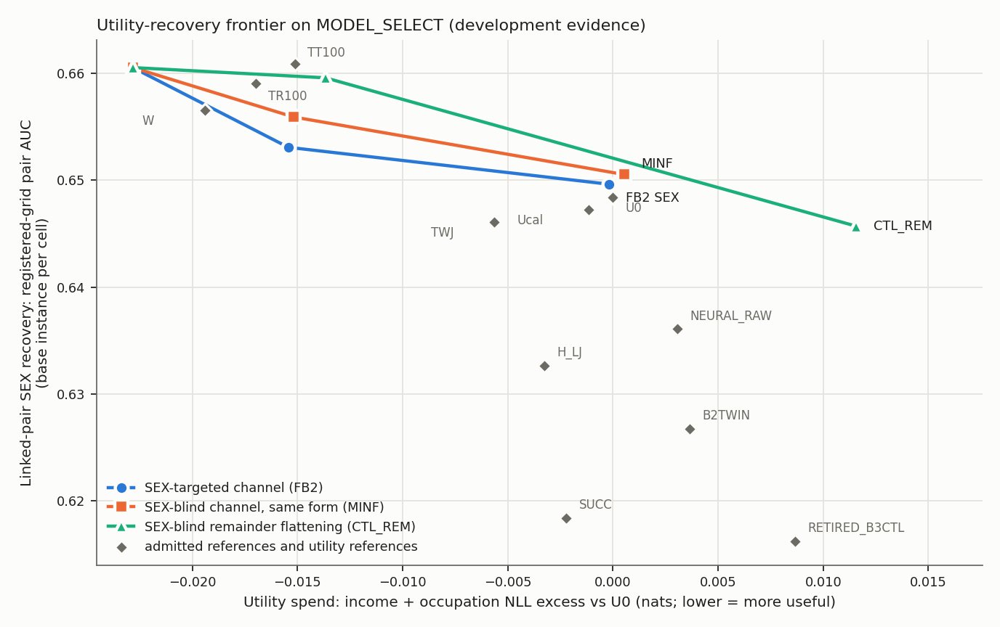

# Advisor brief: looking for a different competitive release mechanism

Campaign `pcrl_new_release_mechanisms_v1`, 2026-10-20 (start 14:29:43Z; runtime and CPU in `RESOURCE_ACCOUNTING.json`, within the
8-hour research window and the 14 CPU-hour budget). Florida ACS 2019 development cohort
(admitted public-use PUMS records): MODEL_FIT, CALIBRATION and MODEL_SELECT roles only. Six input fields; an income recipient and an
occupation recipient each receive only their own probability vector and argmax decision; separate evaluation classifiers ("readers")
estimate the recorded SEX column from the released vectors, and "recovery" is their AUC. Everything below is development evidence on
adaptively used MODEL_SELECT records, for the declared readers only.

**Result in one line:** a finite negative result. Neither mechanism family met the frozen development criteria, and no candidate was
selected. See `RESEARCH_DECISION.md` for the statistical reviewer's required headline wording.

*Pair recovery (registered-grid mean AUC of the base instance per cell, lower is less recovery) against utility spend (total NLL
excess over U0, lower is more useful). Table view: `figures/FRONTIER.csv`. The text below cites the Monte Carlo pooled values for the
randomized releases (`TABLES.md` section 1, last column), which the claims and their uncertainties use.*

## The eight questions

**1. What genuinely different operations were tried?**
- **Family A, propensity-routed finite cells (FA-PRC).** Each person is routed to a finite (income cell, occupation cell) pair chosen
  to trade task cross-entropy against each cell's plug-in SEX information, using a SEX propensity model. The released vectors are
  label-refit cell decoders.
- **Family B, a randomized release.** Version 1 trained task heads through a SEX-targeted Gaussian channel on the logits. Revision
  FB2 applied the same channel law post hoc to a frozen strong task-only base (HC_STRONG income + A1_PO_16 occupation): one standard
  normal draw per person and release along a person-specific, Fisher-regularized SEX direction, with temperatures calibrated on
  CALIBRATION.
- **The challenger's SEX-blind control, CTL_REM:** flatten the occupation remainder toward fixed class shares while keeping the
  decision and the top probability, at strengths chosen by spend only.

**2. How did they differ from earlier failed attempts?** The closed lines were leaf-score corrections of task trees, their
controllers, temperature and nearby strength tuning, finite code banks and quantizers (shared-cell merging, decision-preserving codes)
and adversarial penalties on another dataset. Family A routed on a SEX propensity with a joint pair-and-recipient dependence objective.
Family B was the first randomized release attacked by readers on this cohort. It used no code bank or quantizer (its identity action is
the base itself), and it was compared with a same-form SEX-blind channel (MINF) at matched cost and with a spend-bracketed SEX-blind
deterministic path (CTL_REM).

**3. Which preserved useful task performance?** Within the original limits (24 clauses and 4 guards, both versions): FB2_BASE,
FB2_SEX_S3, FB2_SEX_S5, FB2_MINF_S3, CTL_REM_0p50 and family A's twin. FB2_SEX_S3 also met the two-SE reserve; FB2_SEX_S5 did not
(version-1 reserve ratio 1.53). Every family-B v1 configuration, FB2_MINF_S5 (version-1 occupation NLL at 1.005 times the cap) and
CTL_REM_1p00 (occupation NLL at 1.8-2.2 times the cap and the men's guard at 2.7-3.0 times the cap) failed.

**4. Which lowered recovery beyond matched controls?** None. Pair benefit of the SEX-targeted channel against its same-strength
SEX-blind control: +0.0027 (se 0.0089) at S3 and +0.0019 (se 0.0089) at S5. Against its own twin: +0.0069 (0.0077) and +0.0120
(0.0073), not resolved. The only resolved reduction against a twin anywhere was the SEX-blind control CTL_REM_1p00 (+0.0148, se 0.0060),
which fails utility.

**5. Did the benefit survive stronger and repeated readers?** There was no resolved benefit to carry forward, and the robustness
readers did not change that (descriptive; `roles/reader_robustness/PHASE2_REPORT.md`, `readers/ROBUSTNESS.json`). On 16 new cells (new
repetitions R3/R4 and new reader seeds k2/k3, both versions) every comparison is `ROBUSTNESS_NOT_CONFIRMED`:
- the SEX channel's benefit over its twin keeps its sign in every cell but is never resolved (all 24 cells: +0.0072, se 0.0072 at S3;
  +0.0134, se 0.0080 at S5);
- its edge over the same-strength SEX-blind channel stays near zero and changes sign (all 24 cells: +0.0007, se 0.0087 at S3; +0.0020,
  se 0.0080 at S5);
- every FB2 release stays easier to read than NEURAL_RAW, H_LJ and RETIRED_B3CTL in all 24 cells;
- table readers (LOOKUP, a cross-validated table) never win on these continuous outputs.
Two seed labels apply. The registered grid passes its validity check (A-SC1: `READER_SEEDS_EFFECTIVE`), but the aggregate's
reader-seed qualifier is `READER_SEEDS_PARTLY_EFFECTIVE` (identical k0 and k1 cells in some blocks), so no "across reader seeds"
statement is made.

**6. Original benchmark, reserve-qualified frontier, both or neither?** Neither. Against the nine admitted references:
`NOT_SUPERIOR`, and the 0.020 target is `NOT_MET`. On the reserve-qualified frontier, FB2_SEX_S3 has the lowest pair AUC of the six
reserve-qualified points (0.6536, Monte Carlo pooled), but its benefit is resolved against none of the other five:
`NO_RESERVE_FRONTIER_IMPROVEMENT`.

**7. Was joint-design or novelty established?** No. FB2 makes no joint-design claim, and training through the channel (family B v1)
added nothing in screening. Novelty: family B not claimed (no separate prior-art review); family A has named prior art (privacy funnel,
IBSI, FARE; declared `PRIOR_ART_FOUND`, although its twin's claims record shows G7 `NOT_CLAIMED` because the invalid-grid branch does not
read the declared label). See `CLOSEST_WORK.md`.

**8. Frozen development candidate, useful component or finite negative result?** A finite negative result.

## Strongest evidence on each side

- **Favourable:** a randomized channel kept both tasks inside the original limits at two strengths (S3 also reserve-qualified) and
  lowered pair recovery against its own base by 0.007-0.012 in point estimate. In fit-time records it cut in-sample linear SEX
  discriminability by 36-40% at S5 against 11-14% for the SEX-blind channel.
- **Adverse:** at matched cost the SEX-targeted channel was not separated from the SEX-blind one (+0.0019, se 0.0089); every FB2
  release stays above six of the nine references in recovery; even collapsing the whole occupation remainder left the linked pair at
  0.646, above both target references, while failing the occupation NLL clauses (1.8-2.2 times the cap) and the men's guard (2.7-3.0
  times).

## Limitations

- MODEL_SELECT was used adaptively; FB2 was designed after family-B screening on the same people.
- Standard errors of 0.007-0.009 are about 40% of the 0.020 target. "Not separated" does not mean "equivalent".
- One released instance per person (no repeated-query protection); the declared reader grid only.
- The decisive second phase (ablations and an equally perturbed training repetition) was prepared but not triggered by the frozen
  rules, because no comparison was resolved.

## Recommendation

Do not tune this channel further. Before designing another output mechanism, run a label-light diagnostic of where the SEX
information sits in the released outputs (decisions, confidence, occupation remainder, linked residual). The routes listed as untested in
`RESEARCH_DECISION.md` stay open; this campaign does not show that the gap cannot be closed.
